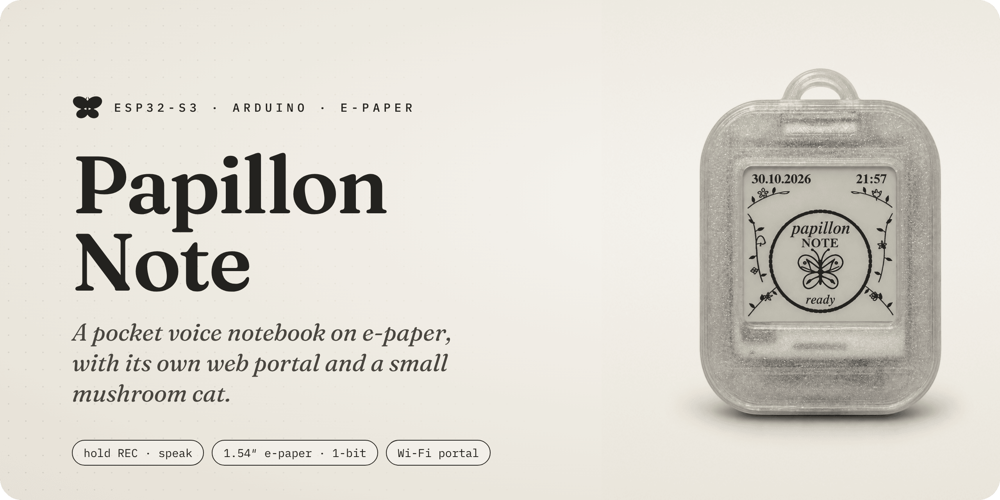
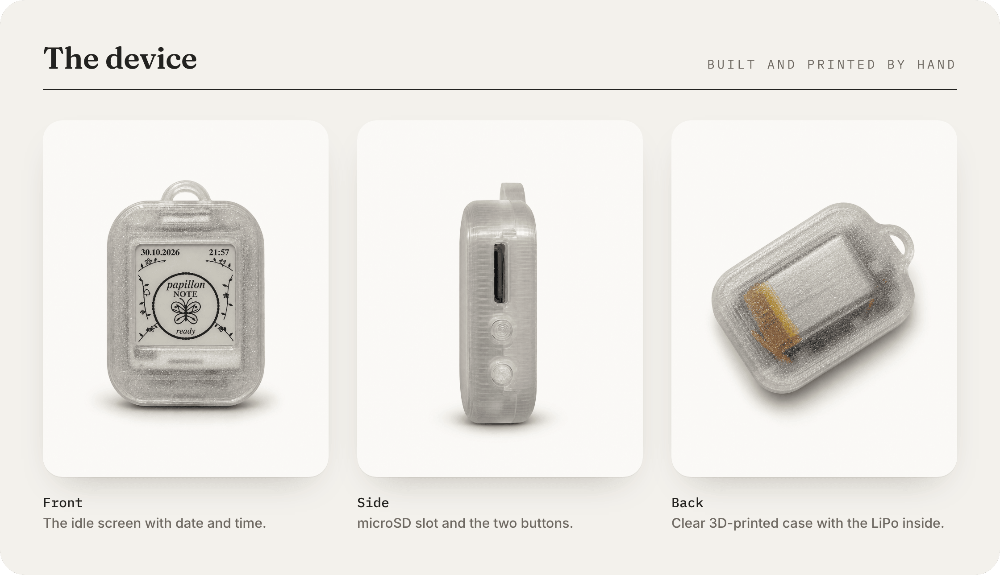
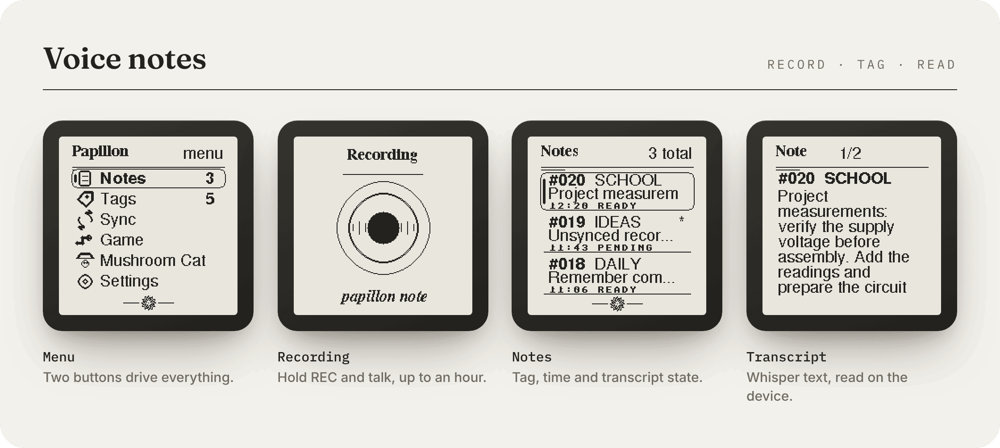
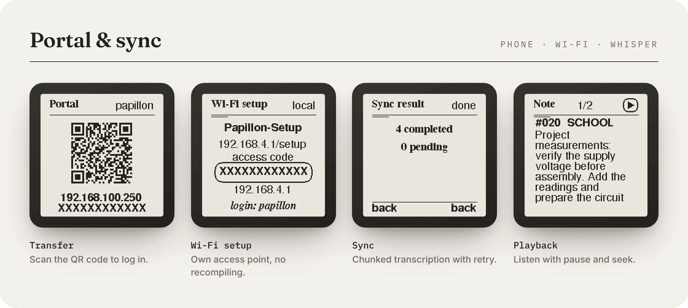
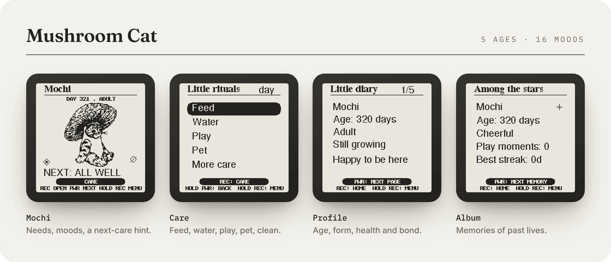
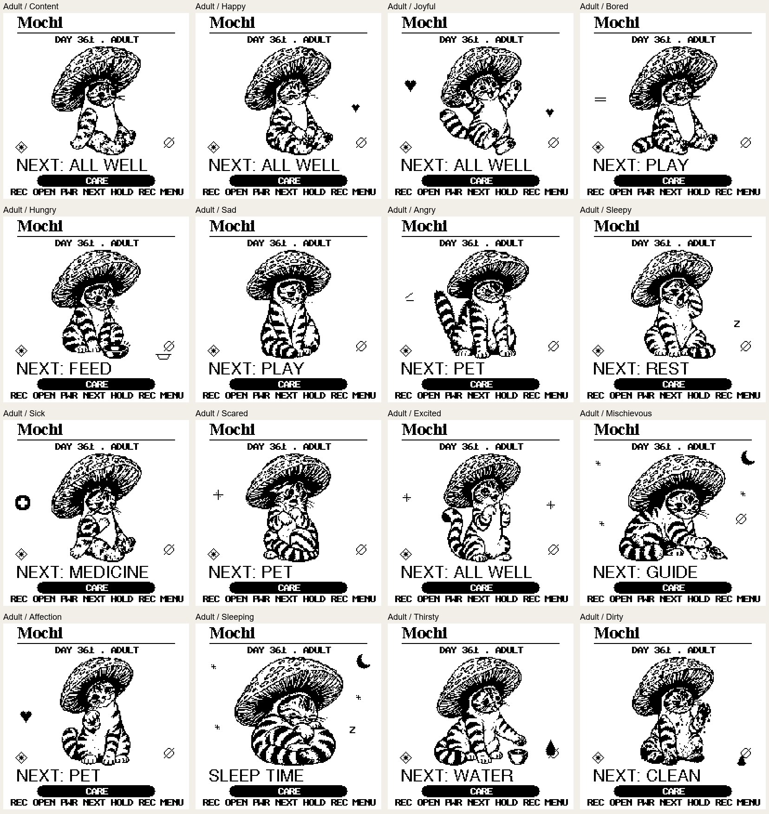
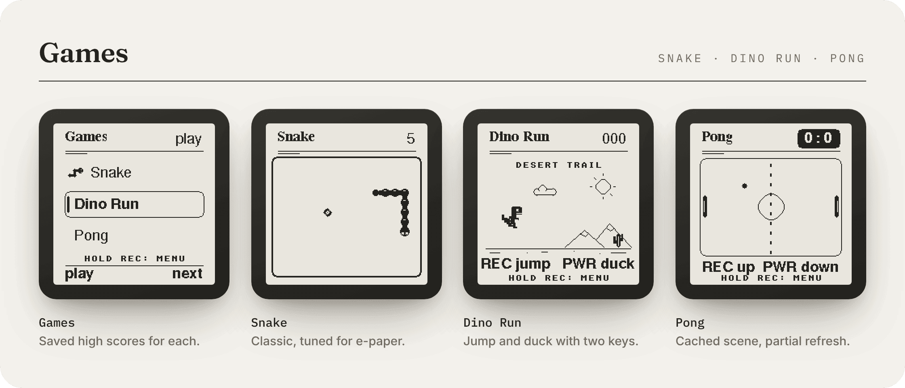

  

  
  
  
  
  

  <b>Hold a button, say what's on your mind, let go.</b> 
  Papillon Note records it to microSD, tags it, transcribes it when Wi-Fi is around, 
  and lets you read and edit everything from your phone.

  <a href="#the-device">The device</a> ·
  <a href="#features">Features</a> ·
  <a href="#hardware">Hardware</a> ·
  <a href="#status">Status</a> ·
  <a href="#how-it-was-made">How it was made</a>

> [!NOTE]
> **Work in progress.** This page shows the project while it is being built. I started it with
> no prior experience in embedded development, and there are still many bugs to fix and a lot to
> optimise, so it is not ready for anyone else to use yet. **The source code is private for now**
> and will be published here once it is. See [Status](#status).

---

## The device

Papillon Note is a small two-button voice recorder built on the
[Waveshare ESP32-S3-ePaper-1.54](https://docs.waveshare.com/ESP32-S3-ePaper-1.54) board.
Everything on the 200×200 black-and-white screen is drawn by the firmware itself: the menus,
the note list, three games and Mochi, a mushroom cat that lives on the device.

The case is a clear 3D print with a lanyard loop; the board, a LiPo cell and the microSD card sit
inside. Every screenshot below is the real production C++ code, rendered on a PC by the host
test suite.

## Features

**Voice notes**
- Hold **REC** to record 16 kHz mono WAV straight to microSD, up to an hour per note.
- Recording starts before the screen and SD card are ready. A PSRAM capture buffer absorbs SD
  latency, so the first words aren't lost.
- Tag a note when you let go (up to 20 custom tags), mark favourites, delete to a trash can.

**Phone portal and transcription**
- *Settings → Transfer* shows a QR code on the e-paper. Scan it and the phone is logged in.
- Search, filter by tag, play, download, edit transcripts, and bulk trash, restore or purge.
- Per-session access code, HTTP Basic Auth and CSRF tokens. The portal closes itself after
  10 minutes without activity.
- A setup access point for adding Wi-Fi networks and the API key without recompiling, and a
  button that copies the phone's clock to the device.
- Optional transcription through the OpenAI Whisper API, sent in chunks with retry and cancel.
  A new transcript replaces the old one only after every part has arrived.

**Mushroom Cat**
- Five life stages and 16 moods each: 80 one-bit portraits.
- Food, water, cleanliness, sleep, play and training needs, care actions, a profile and an
  album of past lives. A `NEXT:` hint on the home screen always says what Mochi needs.

<b>All 16 moods of an adult Mochi</b>

 

**Games**: Snake, Dino Run and Pong, with saved high scores. A cached static scene and partial
refresh keep them playable on e-paper.

**Under the hood**
- Own SPI driver for the SSD1681 panel with partial refresh, periodic cleanup, and a refresh
  waveform chosen from the board's SHTC3 temperature sensor.
- Deep sleep with button wake, stuck-button protection, a timeout or "always on".
- Battery monitoring that refuses to write to SD or flash when the cell is too low.
- PCF85063 RTC with NTP sync, Swiss summer/winter time, and recovery when the clock is lost.

## Hardware

| Part | Details |
|---|---|
| Board | [Waveshare ESP32-S3-ePaper-1.54](https://docs.waveshare.com/ESP32-S3-ePaper-1.54): ESP32-S3-PICO-1-N8R8, 8 MB flash, 8 MB OPI PSRAM |
| Display | 1.54″ 200×200 black/white e-paper, SSD1681 controller |
| Audio | ES8311 codec with the on-board microphone and speaker |
| Other | PCF85063 RTC, SHTC3 temperature/humidity sensor, microSD slot, LiPo battery |
| Buttons | **REC** (GPIO0 / BOOT) and **PWR** (GPIO18) |
| Case | Clear 3D-printed case with a lanyard loop. The print files will be added later. |

<b>Pin map</b>

 

| Function | GPIO / address |
|---|---|
| E-paper DC / CS / SCK / MOSI / RST / BUSY | 10 / 11 / 12 / 13 / 9 / 8 |
| E-paper power | 6 (low = on) |
| Audio power / amplifier | 42 / 46 |
| Battery latch / PWR key | 17 / 18 |
| REC (BOOT) | 0 |
| Battery ADC | 4 (1/2 divider) |
| I²C SDA / SCL | 47 / 48 (RTC 0x51, SHTC3 0x70, ES8311 0x18) |
| SD CLK / CMD / D0 | 39 / 41 / 40 (SDMMC 1-bit) |
| I²S MCLK / BCLK / WS / DIN / DOUT | 14 / 15 / 38 / 16 / 45 |

## Status

Papillon Note is still in development. I started it from zero, without any background in
firmware, e-paper or audio, so a lot of it is the result of trial and error on the real device.
It works, but it is **not ready for everyday use yet**. Known problems and open work include:

- **Display:** ghosting and leftover traces after partial refreshes, and refresh speed on menus
  and in the games.
- **Power:** the deep-sleep current has not been measured, and battery percentage is only an
  estimate from the cell voltage.
- **Bugs:** there are still bugs to find and fix, and not every feature has been fully tested
  on the device.
- **Code:** several files have grown large and need refactoring and optimisation.
- **Case:** the 3D print files will be published later.

When the firmware is stable enough to use, the source code, build instructions and case files
will be published in this repository. Feedback and ideas are welcome in the meantime.

## How it was made

I chose the hardware, tested every build on the real device and made the design decisions.
Much of the code was written with the help of AI coding assistants. The Mushroom Cat artwork is
AI-generated and converted to 1-bit for the e-paper screen.

## Credits

Built on Waveshare's ESP32-S3-ePaper-1.54 board and its demo code. The firmware also uses
Espressif's audio codec drivers and Project Nayuki's QR code generator.

© 2026 1bslinux-web. All rights reserved. The photos, artwork and text in this repository may
not be reused without permission.
